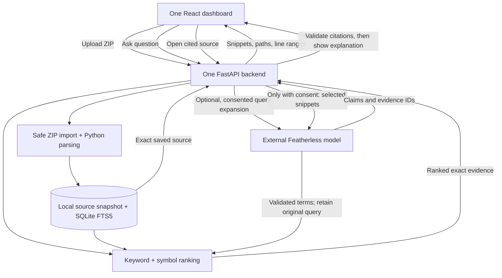

# Brahmaniss - Simple Implementation Plan

**Status:** In progress — tasks 1-5 done. See `spec.md` for requirements and checks.

## 1. Architecture



These are components inside one application, not separate services. Search is
local; optional query expansion and the explanation use an external model.

## 2. Tech stack

| Part | Choice | Why |
|---|---|---|
| Frontend | React + TypeScript + Vite | One responsive dashboard |
| Backend | Python + FastAPI | Small typed HTTP API |
| Parsing | Python standard-library `ast` | Reliable source positions for our initial Python-only scope |
| Storage/search | SQLite + FTS5 | Persistent local index; no search server |
| AI | Featherless via an OpenAI-compatible client | Optional search terms and evidence-based explanations |
| Validation | pytest, Ruff, frontend typecheck/lint/tests/build, Playwright | Check behaviour and the complete browser flow |

No OpenCode dependency, embeddings, vector database, agent framework, graph,
accounts, or distributed infrastructure.

## 3. How it works

### Upload once

Validate a bounded ZIP, filter out unwanted files, save the admitted Python
source, extract functions/classes and code chunks, then populate SQLite.
Publish the index only after successful completion. Show skipped-file counts.
Keep the old ready index if a replacement fails.

Use exact saved source and snapshot IDs for evidence. Do not execute code or
write back to the uploaded project. Parse failures use labelled line windows.

### Search many times

Normalize question terms and split identifiers. Retrieve keyword matches with
FTS5 and independently match symbols/paths. Combine ranks, remove duplicate
regions, and return up to ten results with match reasons.

This is lexical + symbol hybrid search. It does not need an LLM or embeddings.
Keep query handling bounded and parameterized.

Once the local baseline works, optionally ask AI for a few related search terms.
Validate and search those alongside the original query. A timeout or invalid
response must fall back to ordinary local search. Measure whether expansion
helps rather than assuming it always improves retrieval.

### Explain only the evidence

After explicit consent, send the question and at most five selected snippets to
Featherless. Validate the response and evidence IDs before showing the explanation.
Paths and line numbers always come from our index.

If evidence is insufficient or AI fails, say so and keep source results usable.
Never describe citation validation as a guarantee that every AI claim is true.

General programming questions take a separate, clearly labelled general-answer
path. They do not need repository search and must not be presented as verified
behaviour of the uploaded code. This is not an unrestricted general-purpose chat
application.

## 4. Keep the code small

```text
backend/
  pyproject.toml
  app/
    main.py            # API, configuration, local access protection
    indexing.py        # ZIP safety, filtering, Python symbols/chunks
    storage.py         # SQLite and exact saved-source access
    search.py          # Keyword/symbol retrieval and ranking
    explain.py         # Provider calls and citation validation
  tests/
frontend/
  package.json
  src/                 # Page, components, API client, styles
evaluation/
  cases.json           # Ten verified questions and expected locations
.brahmaniss/           # Private generated state; gitignored
```

Split modules further only when necessary. Use one bounded in-process import task,
not a job platform. Local-folder imports and multiple stored projects are outside
the first version.

## 5. Task-by-task build plan

| Step | Build | Prove it works |
|---|---|---|
| 1. Foundation | Scaffold React/TypeScript and FastAPI; configure local state/access, manifests, and health/FTS5 probes; select the frozen demo repository and begin manual question labels; identify provider access/configuration needs | Frontend reaches the backend; SQLite can create and query an FTS5 table; evaluation inputs are known; missing model access is visible without blocking local work |
| 2. ZIP input | Bounded upload, safe paths, exclusions, private staging/source snapshot, and clear progress/errors | Valid ZIP is admitted; unsafe/oversized input rejects; failed replacement preserves the current snapshot |
| 3. Parse code | Python AST functions/classes/methods, module-level regions, exact ranges, bounded chunks, labelled fallback | Known source produces accurate symbols and snippets, including Unicode and newline edge cases |
| 4. Local index | Persist files/chunks and populate FTS5 fields for symbols, paths, identifier tokens, and code; publish atomically | Words find stored chunks; source/index survives restart; stale snapshot IDs never select another upload |
| 5. Local search | Normalize questions, weighted keyword retrieval, independent symbol matching, rank fusion, deduplication, match reasons; run the labelled development questions now | Record baseline retrieval hits/misses before AI or UI polish; feature and exact-symbol questions retrieve relevant regions; no-match and punctuation cases behave correctly |
| 6. Evidence UI | Connect upload/status, question box, ranked code cards, and highlighted saved-source viewer | Browser completes ZIP -> question -> actual source; stale responses cannot overwrite newer results |
| 7. Optional AI search help | Consented, bounded query-term expansion using the same provider adapter; retain the original-query candidate list | Compare retrieval with/without expansion; bad output or timeout leaves ordinary search usable |
| 8. AI answers | Explain at most five approved snippets, validate claim/citation structure, and add a separately labelled general-programming answer path | Real consented model call works; unknown citations/uncited claims reject; general answers never masquerade as source evidence |
| 9. Release checks | Ten manually verified answerable questions plus negatives, timings, focused tests, lint/build, README, and demo | Report real retrieval results, verify the built browser workflow, and provide reproducible setup and a demo under three minutes |

**First milestone:** one uploaded repository, one question, one correct source
result after tasks 1-5. Build that before UI polish or AI integration.

Implement one task at a time and run its focused checks before moving on. Tasks
1-6 establish the useful AI-free source-discovery workflow. Task 7 remains an
optional enhancement, not a dependency of task 8. No team code or OpenCode is
used as the starting point, and this plan does not authorize commits or pushes.

Evaluation begins with task 1, not only at release. Keep some manually labelled
questions held out from search tuning and use them in task 9. Source fidelity,
provider failure handling, and retrieval quality must be demonstrated; a complete
plan is not a guarantee of perfect search or supported AI claims.

## 6. How to build and run

These are intended steps, **not runnable setup instructions yet**. Implementation
will provide pinned manifests, a frontend lockfile, and the named scripts.

1. Create a Python virtual environment and install the backend plus development
   dependencies from its manifest. Choose a runtime with AST end positions.
2. Configure a private state directory and local access settings. Set the
   Featherless key/model only on the backend; do not guess an account's model ID.
3. Start FastAPI on loopback with Uvicorn. Configure the Vite development server
   to proxy `/api` to it.
4. Install frontend dependencies from the lockfile and start Vite.
5. Run pytest/Ruff and frontend typecheck/lint/tests. Run the browser workflow and
   ten-question evaluation against a frozen public repository.
6. Build frontend assets with `npm run build`; serve them from FastAPI for a
   single-origin local demo. Keep API routes separate from the page fallback.
7. Verify the built application, including search-only operation and one real
   consented AI answer. Record a working prototype video under three minutes.

## 7. Reliability without extra infrastructure

Index once and persist it. Bound upload size, expanded bytes, file count, parsing,
and query work. Never follow archive paths outside staging or execute source.
Keep citations tied to the correct saved upload. Protect local APIs from unrelated
websites, keep secrets out of logs/frontend, and let search survive AI failure.

The goal is not the largest architecture. It is a small workflow that consistently
finds real code and makes its evidence easy to verify.
